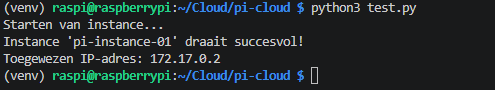
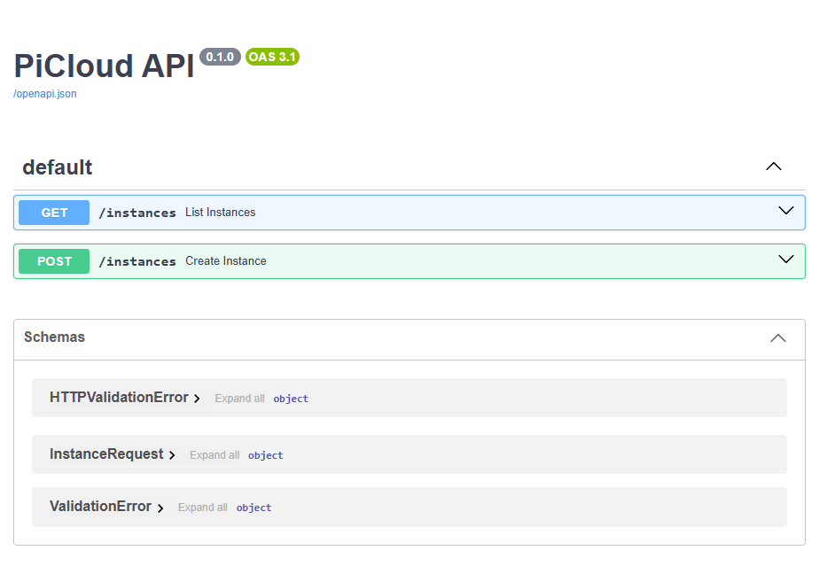
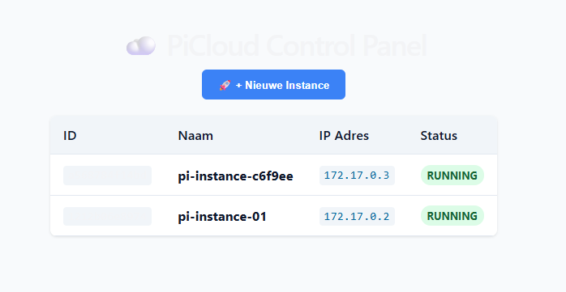
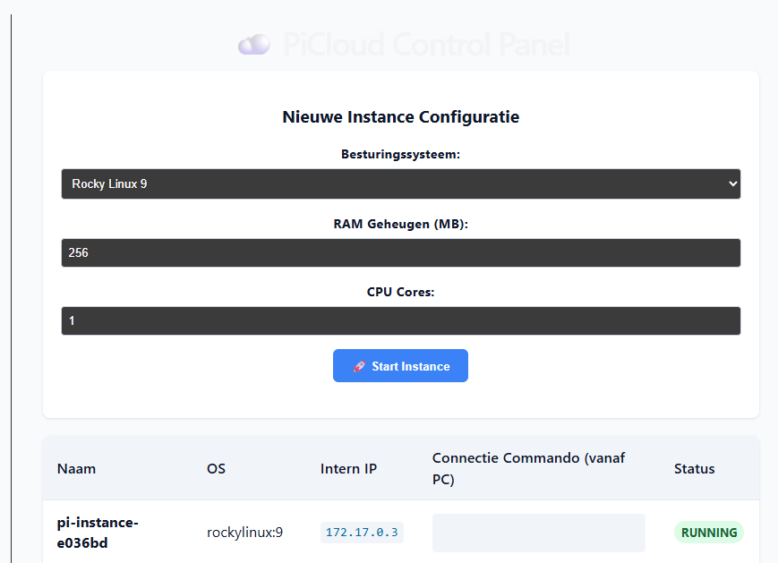
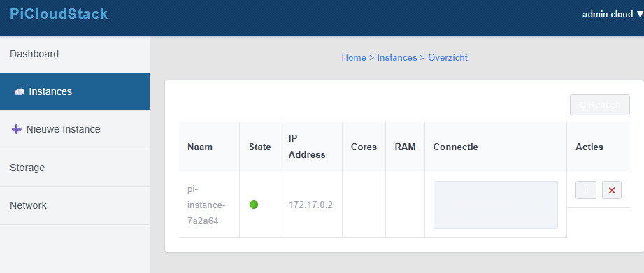
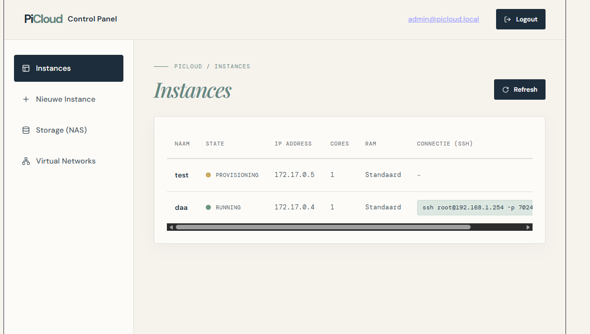

# ☁️ PiCloud: Eigen IaaS Cloud op een Raspberry Pi (Deel 1)

Dit logboek beschrijft de eerste stappen voor het bouwen van een eigen Infrastructure as a Service (IaaS) platform op een Raspberry Pi. We zetten Docker op als hypervisor, bouwen een Python FastAPI backend om containers te beheren, en maken een Vue.js frontend voor het dashboard.

---

## 1. Voorbereiding: Docker Installeren
Allereerst maken we verbinding met de Raspberry Pi via SSH en installeren we Docker. Docker zal fungeren als de motor die onze virtuele instances (containers) draait.

```bash
# Installeer Docker en de benodigde componenten
sudo dnf install -y docker-ce docker-ce-cli containerd.io

# Start de service en zorg dat deze automatisch opstart
sudo systemctl enable --now docker

# Voeg de huidige gebruiker toe aan de docker groep (geen sudo meer nodig voor docker commando's)
sudo usermod -aG docker $USER
```
*(Pas de groepsrechten direct toe door `newgrp docker` uit te voeren, of log even uit en in).*

---

## 2. Python Omgeving & Docker SDK Test
We creëren een geïsoleerde Python virtuele omgeving om de afhankelijkheden van onze backend netjes gescheiden te houden van het systeem.

```bash
mkdir -p ~/Cloud/cloud-pi
cd ~/Cloud/cloud-pi

# Maak en activeer de virtuele omgeving
python3 -m venv venv
source venv/bin/activate

# Installeer de Docker SDK voor Python
pip install docker
```

### De Connectie Testen
We maken een kort script (`test.py`) om te verifiëren of onze Python-omgeving succesvol instances kan aanmaken en uitlezen via Docker.

```python
# test.py
import docker

client = docker.from_env()

print("Starten van instance...")
container = client.containers.run(
    "ubuntu:latest", 
    command="sleep infinity",
    detach=True, 
    name="pi-instance-01"
)

# Wacht tot de container netwerkgegevens heeft ontvangen
container.reload()

# Veilige manier om het toegewezen IP-adres uit te lezen
networks = container.attrs['NetworkSettings']['Networks']
netwerk_naam = list(networks.keys())[0] # Pak het eerste netwerk (meestal 'bridge')
ip_adres = networks[netwerk_naam]['IPAddress']

print(f"Instance '{container.name}' draait succesvol!")
print(f"Toegewezen IP-adres: {ip_adres}")
```

**Test het script:**
```bash
python3 test.py
```
*(Output toont succesvolle creatie en IP-toewijzing)*  


---

## 3. De FastAPI Backend Bouwen
Nu we instances kunnen maken, bouwen we een REST API zodat ons dashboard straks met de Raspberry Pi kan praten.

```bash
pip install fastapi uvicorn pydantic
```

Maak het bestand `api.py`. Hierin definiëren we de API-endpoints en voegen we direct CORS (Cross-Origin Resource Sharing) toe, zodat onze frontend-applicatie verzoeken mag sturen.

```python
# api.py
from fastapi import FastAPI
from fastapi.middleware.cors import CORSMiddleware
from pydantic import BaseModel
import docker
import uuid

app = FastAPI(title="PiCloud API")
client = docker.from_env()

# CORS instellen voor communicatie met de Vue frontend
app.add_middleware(
    CORSMiddleware,
    allow_origins=["*"], # In productie vervangen door specifiek frontend IP/Domein
    allow_credentials=True,
    allow_methods=["*"],
    allow_headers=["*"],
)

# Data model voor het aanmaken van een instance
class InstanceRequest(BaseModel):
    image: str = "ubuntu:latest"

@app.get("/instances")
def list_instances():
    """Haalt een lijst op van alle actieve PiCloud instances."""
    containers = client.containers.list(all=True, filters={"name": "pi-instance-"})
    
    instances = []
    for c in containers:
        networks = c.attrs.get('NetworkSettings', {}).get('Networks', {})
        ip_adres = "Geen IP"
        if networks:
            netwerk_naam = list(networks.keys())[0]
            ip_adres = networks[netwerk_naam].get('IPAddress', "Geen IP")

        instances.append({
            "id": c.short_id,
            "name": c.name,
            "status": c.status,
            "ip": ip_adres,
            "image": c.image.tags[0] if c.image.tags else "unknown"
        })
        
    return {"instances": instances}

@app.post("/instances")
def create_instance(req: InstanceRequest):
    """Maakt een nieuwe instance (container) aan met een unieke ID."""
    unique_id = str(uuid.uuid4())[:6]
    name = f"pi-instance-{unique_id}"
    
    container = client.containers.run(
        req.image, 
        command="sleep infinity",
        detach=True, 
        name=name
    )
    
    container.reload()
    networks = container.attrs['NetworkSettings']['Networks']
    netwerk_naam = list(networks.keys())[0]
    ip_adres = networks[netwerk_naam]['IPAddress']
    
    return {
        "message": "Instance succesvol gestart!",
        "name": name,
        "ip": ip_adres,
        "id": container.short_id
    }
```

**Start de API:**
```bash
uvicorn api:app --host 0.0.0.0 --port 8000
```
De interactieve documentatie (Swagger UI) is nu bereikbaar via: `http://<JOUW_PI_IP>:8000/docs/`  


---

## 4. De Vue.js Frontend Bouwen
Om het beheer visueel te maken, zetten we een Vue.js applicatie op met Vite.

```bash
# Installeer Node.js & npm (indien nog niet geïnstalleerd)
sudo apt update
sudo apt install -y nodejs npm

# Genereer het project
cd ~/Cloud
npm create vite@latest picloud-frontend -- --template vue
cd picloud-frontend

# Installeer afhankelijkheden en axios voor API requests
npm install
npm install axios
```

Vervang de inhoud van `src/App.vue` met het volgende dashboard-ontwerp:

```vue
<!-- src/App.vue -->
<script setup>
import { ref, onMounted } from 'vue'
import axios from 'axios'

const instances = ref([])
const loading = ref(false)

// Configuraties - Vervang door jouw Pi's IP in productie of gebruik .env
const apiBase = 'http://<JOUW_PI_IP>:8000' 

const fetchInstances = async () => {
  try {
    const res = await axios.get(`${apiBase}/instances`)
    instances.value = res.data.instances
  } catch (error) {
    console.error("Kon instances niet ophalen", error)
  }
}

const createInstance = async () => {
  loading.value = true
  try {
    await axios.post(`${apiBase}/instances`, { image: 'ubuntu:latest' })
    await fetchInstances() // Ververs de lijst direct
  } catch (error) {
    console.error("Fout bij aanmaken", error)
  }
  loading.value = false
}

// Initialiseer data bij het laden van de pagina
onMounted(fetchInstances)
</script>

<template>
  <div class="dashboard">
    <h1>☁️ PiCloud Control Panel</h1>
    
    <button class="btn-create" @click="createInstance" :disabled="loading">
      {{ loading ? '⏳ Container aanmaken...' : '🚀 + Nieuwe Instance' }}
    </button>

    <div v-if="instances.length" class="table-container">
      <table>
        <thead>
          <tr>
            <th>ID</th>
            <th>Naam</th>
            <th>IP Adres</th>
            <th>Status</th>
          </tr>
        </thead>
        <tbody>
          <tr v-for="inst in instances" :key="inst.id">
            <td><code>{{ inst.id }}</code></td>
            <td><strong>{{ inst.name }}</strong></td>
            <td><code class="ip">{{ inst.ip }}</code></td>
            <td>
              <span :class="['badge', inst.status === 'running' ? 'badge-green' : 'badge-gray']">
                {{ inst.status }}
              </span>
            </td>
          </tr>
        </tbody>
      </table>
    </div>
    <p v-else class="empty-state">Geen instances gevonden. Maak er een aan!</p>
  </div>
</template>

<style>
body { font-family: 'Inter', system-ui, sans-serif; background: #f8fafc; color: #0f172a; margin: 0; padding: 2rem; }
.dashboard { max-width: 800px; margin: 0 auto; }
.btn-create { background: #3b82f6; color: white; border: none; padding: 10px 20px; border-radius: 6px; font-weight: bold; cursor: pointer; margin-bottom: 20px; transition: 0.2s; }
.btn-create:hover:not(:disabled) { background: #2563eb; }
.btn-create:disabled { background: #94a3b8; cursor: not-allowed; }
table { width: 100%; border-collapse: collapse; background: white; box-shadow: 0 1px 3px rgba(0,0,0,0.1); border-radius: 8px; overflow: hidden; }
th, td { text-align: left; padding: 12px 16px; border-bottom: 1px solid #e2e8f0; }
th { background: #f1f5f9; font-weight: 600; }
code { background: #f1f5f9; padding: 2px 6px; border-radius: 4px; font-family: monospace; font-size: 0.9em; }
.ip { color: #0369a1; }
.badge { padding: 4px 8px; border-radius: 12px; font-size: 0.8em; font-weight: bold; text-transform: uppercase; }
.badge-green { background: #dcfce7; color: #166534; }
.badge-gray { background: #f1f5f9; color: #475569; }
</style>
```

---

## 5. Applicatie Draaien
Om het volledige platform te testen, start je beide services.

**Terminal 1 (Backend):**
```bash
cd ~/Cloud/cloud-pi
source venv/bin/activate
uvicorn api:app --host 0.0.0.0 --port 8000
```

**Terminal 2 (Frontend):**
```bash
cd ~/Cloud/picloud-frontend
npm run dev -- --host
```

Het dashboard is nu toegankelijk, en je kunt direct nieuwe instances lanceren!  



# ☁️ PiCloud: Eigen IaaS Cloud op een Raspberry Pi (Deel 2)

In dit tweede deel maken we ons IaaS-platform geavanceerder. We breiden de backend en frontend uit zodat we het besturingssysteem kunnen kiezen, hardware-limieten (RAM en CPU) kunnen instellen, en de instances van buitenaf kunnen benaderen via SSH door middel van *Port Forwarding*.

---

## 1. De Backend Upgraden (Geavanceerde API)
We passen ons `api.py` script aan om meer opties te ondersteunen. 

**Waarom doen we dit?** 
1. **Resource Management:** Zonder limieten kan één container alle resources van de Raspberry Pi opslokken. We voegen CPU en RAM limieten toe.
2. **SSH Toegang:** Containers zitten standaard geïsoleerd in een intern Docker-netwerk. Door een willekeurige poort op de host (de Pi) te mappen naar poort 22 van de container (Port Forwarding), kunnen we vanaf elke pc in ons netwerk inloggen via SSH.

Vervang de inhoud van `api.py` door de volgende code:

```python
# api.py
from fastapi import FastAPI
from fastapi.middleware.cors import CORSMiddleware
from pydantic import BaseModel
import docker
import uuid
import random

app = FastAPI(title="PiCloud API")
client = docker.from_env()

app.add_middleware(
    CORSMiddleware,
    allow_origins=["*"], # Tip: Beperk dit in productie tot het IP van je frontend
    allow_credentials=True,
    allow_methods=["*"],
    allow_headers=["*"],
)

# Het uitgebreide formulier model
class InstanceRequest(BaseModel):
    os_choice: str
    memory_mb: int
    cpu_cores: float

@app.get("/instances")
def list_instances():
    """Haalt alle instances op en leest de toegewezen SSH host-poort uit."""
    containers = client.containers.list(all=True, filters={"name": "pi-instance-"})
    instances = []
    
    for c in containers:
        networks = c.attrs.get('NetworkSettings', {}).get('Networks', {})
        ip_adres = "Geen IP"
        if networks:
            netwerk_naam = list(networks.keys())[0]
            ip_adres = networks[netwerk_naam].get('IPAddress', "Geen IP")

        # Lees de toegewezen host-poort uit voor SSH-connecties
        ports = c.attrs.get('NetworkSettings', {}).get('Ports', {})
        ssh_port = "Geen"
        if '22/tcp' in ports and ports['22/tcp'] is not None:
            ssh_port = ports['22/tcp'][0]['HostPort']

        instances.append({
            "id": c.short_id,
            "name": c.name,
            "status": c.status,
            "ip": ip_adres,
            "ssh_port": ssh_port,
            "image": c.image.tags[0] if c.image.tags else "unknown"
        })
    return {"instances": instances}

@app.post("/instances")
def create_instance(req: InstanceRequest):
    """Deployt een instance met specifieke OS, resources en een SSH server."""
    unique_id = str(uuid.uuid4())[:6]
    name = f"pi-instance-{unique_id}"
    
    # Wijs een willekeurige poort toe tussen 2200 en 9000 voor SSH
    host_ssh_port = random.randint(2200, 9000)
    
    # OS-specifieke SSH installatie en configuratie commando's
    # LET OP: Vervang <JOUW_WACHTWOORD> door een sterk wachtwoord
    if req.os_choice == "rocky":
        image_tag = "rockylinux:9"
        startup_cmd = "bash -c 'dnf install -y openssh-server && ssh-keygen -A && echo \"root:<JOUW_WACHTWOORD>\" | chpasswd && echo \"PermitRootLogin yes\" >> /etc/ssh/sshd_config && echo \"PasswordAuthentication yes\" >> /etc/ssh/sshd_config && /usr/sbin/sshd -D'"
    else:
        image_tag = "ubuntu:latest"
        startup_cmd = "bash -c 'apt-get update && apt-get install -y openssh-server && mkdir -p /var/run/sshd && echo \"root:<JOUW_WACHTWOORD>\" | chpasswd && echo \"PermitRootLogin yes\" >> /etc/ssh/sshd_config && echo \"PasswordAuthentication yes\" >> /etc/ssh/sshd_config && /usr/sbin/sshd -D'"
    
    # Converteer limieten naar Docker-formaat
    mem_limit = f"{req.memory_mb}m"
    nano_cpus = int(req.cpu_cores * 1e9) # Docker rekent in nano-CPU's
    
    # Start container mét Port Forwarding en resource limits
    container = client.containers.run(
        image_tag, 
        command=startup_cmd,
        detach=True, 
        name=name,
        mem_limit=mem_limit,
        nano_cpus=nano_cpus,
        ports={'22/tcp': host_ssh_port} # Map poort 22 naar de random host_ssh_port
    )
    
    container.reload()
    networks = container.attrs['NetworkSettings']['Networks']
    ip_adres = networks[list(networks.keys())[0]]['IPAddress']
    
    return {"message": "Instance gestart!", "name": name, "ip": ip_adres, "ssh_port": host_ssh_port}
```

---

## 2. De Frontend Upgraden (Geavanceerd Dashboard)
We updaten ons Vue.js dashboard zodat we de nieuwe API-mogelijkheden kunnen gebruiken. 

**Waarom doen we dit?**
De gebruiker moet parameters (zoals RAM en CPU) kunnen invullen bij het aanmaken van een instance. Daarnaast moet het dashboard het gegenereerde SSH-commando tonen, zodat de gebruiker de instance direct kan benaderen.

Vervang de inhoud van `src/App.vue`:

```vue
<!-- src/App.vue -->
<script setup>
import { ref, onMounted } from 'vue'
import axios from 'axios'

const instances = ref([])
const loading = ref(false)
const apiBase = 'http://<JOUW_PI_IP>:8000' 

// State voor het formulier (Standaardwaarden)
const form = ref({
  os_choice: 'ubuntu',
  memory_mb: 512,
  cpu_cores: 1
})

const fetchInstances = async () => {
  try {
    const res = await axios.get(`${apiBase}/instances`)
    instances.value = res.data.instances
  } catch (error) {
    console.error(error)
  }
}

const createInstance = async () => {
  loading.value = true
  try {
    // Stuur de formulier data mee in het POST request
    await axios.post(`${apiBase}/instances`, form.value)
    await fetchInstances()
  } catch (error) {
    console.error(error)
  }
  loading.value = false
}

onMounted(fetchInstances)
</script>

<template>
  <div class="dashboard">
    <h1>☁️ PiCloud Control Panel</h1>
    
    <div class="create-card">
      <h3>Nieuwe Instance Configuratie</h3>
      <div class="form-group">
        <label>Besturingssysteem:</label>
        <select v-model="form.os_choice">
          <option value="ubuntu">Ubuntu (Latest)</option>
          <option value="rocky">Rocky Linux 9</option>
        </select>
      </div>
      <div class="form-group">
        <label>RAM Geheugen (MB):</label>
        <input type="number" v-model="form.memory_mb" step="256" min="256" max="6144">
      </div>
      <div class="form-group">
        <label>CPU Cores:</label>
        <input type="number" v-model="form.cpu_cores" step="0.5" min="0.5" max="4">
      </div>
      <button class="btn-create" @click="createInstance" :disabled="loading">
        {{ loading ? '⏳ Container maken & SSH configureren...' : '🚀 Start Instance' }}
      </button>
    </div>

    <div v-if="instances.length" class="table-container">
      <table>
        <thead>
          <tr>
            <th>Naam</th>
            <th>OS</th>
            <th>Intern IP</th>
            <th>Connectie Commando (vanaf PC)</th>
            <th>Status</th>
          </tr>
        </thead>
        <tbody>
          <tr v-for="inst in instances" :key="inst.id">
            <td><strong>{{ inst.name }}</strong></td>
            <td>{{ inst.image }}</td>
            <td><code class="ip">{{ inst.ip }}</code></td>
            <td>
              <!-- Toon het gegenereerde SSH commando als Port Forwarding is gelukt -->
              <code v-if="inst.ssh_port !== 'Geen'" class="ssh-cmd">
                ssh root@<JOUW_PI_IP> -p {{ inst.ssh_port }}
              </code>
              <span v-else class="badge badge-gray">Geen SSH</span>
            </td>
            <td>
              <span :class="['badge', inst.status === 'running' ? 'badge-green' : 'badge-gray']">
                {{ inst.status }}
              </span>
            </td>
          </tr>
        </tbody>
      </table>
      <p style="font-size: 0.85em; color: #64748b; margin-top: 10px;">
        <em>Wachtwoord voor alle nieuwe instances vind je in de API configuratie. (Het kan ~10 seconden duren na aanmaken voordat de SSH-service binnen de container is geïnstalleerd en gereed is).</em>
      </p>
    </div>
  </div>
</template>

<style>
/* Voeg deze stijlen toe onder de stijlen uit Deel 1 */
.create-card { background: white; padding: 20px; border-radius: 8px; box-shadow: 0 1px 3px rgba(0,0,0,0.1); margin-bottom: 20px; }
.form-group { margin-bottom: 15px; }
.form-group label { display: block; font-weight: bold; margin-bottom: 5px; font-size: 0.9em; }
.form-group select, .form-group input { width: 100%; padding: 8px; border: 1px solid #cbd5e1; border-radius: 4px; box-sizing: border-box; }
.ssh-cmd { background: #1e293b; color: #38bdf8; }
</style>
```

---

## 3. Applicatie Starten en Testen
Herstart beide services om de nieuwe code actief te maken.

**In de backend terminal (`~/Cloud/pi-cloud`):**
```bash
uvicorn api:app --host 0.0.0.0 --port 8000
```

**In de frontend terminal (`~/Cloud/picloud-frontend`):**
```bash
npm run dev -- --host
```

Ga naar het dashboard in je browser en maak een instance aan. Zodra de creatie voltooid is, verschijnt er een specifiek poortnummer in de tabel (bijv. `3392`).

Je kunt nu vanaf je eigen pc direct inloggen op de virtuele instance via SSH:
```bash
ssh root@<JOUW_PI_IP> -p <GEGENEREERDE_POORT>
```
*(In het voorbeeld hieronder: `ssh root@192.168.1.254 -p 3392`)*




# ☁️ PiCloud: Eigen IaaS Cloud op een Raspberry Pi (Deel 3)

In dit derde deel tillen we PiCloud naar een professioneel Enterprise-niveau. We breiden de API uit met lifecycle management (starten, stoppen, verwijderen van instances) en geven de Vue.js frontend een complete make-over, geïnspireerd op de klassieke *Apache CloudStack* interface. Tot slot voegen we live status-updates toe.

---

## 1. Backend: Lifecycle Management & Status Polling
We updaten onze FastAPI backend (`api.py`) met nieuwe endpoints en een geavanceerdere statuscontrole.

**Waarom doen we dit?**
1. **Lifecycle Control:** Een cloud is pas bruikbaar als je virtuele machines ook kunt pauzeren (stoppen) en vernietigen (verwijderen) om resources vrij te maken.
2. **Accurate Status:** Een Docker container is vrijwel direct 'running', maar het opstarten van het OS en de SSH-server duurt even. We voegen een check toe (`pgrep sshd`) om de status 'provisioning' (installeren) te tonen totdat SSH echt klaar is.

Vervang de inhoud van `api.py`:

```python
# api.py
from fastapi import FastAPI, HTTPException
from fastapi.middleware.cors import CORSMiddleware
from pydantic import BaseModel
import docker
import uuid
import random

app = FastAPI(title="PiCloud API")
client = docker.from_env()

app.add_middleware(
    CORSMiddleware,
    allow_origins=["*"], # In productie: IP van je frontend
    allow_credentials=True,
    allow_methods=["*"],
    allow_headers=["*"],
)

class InstanceRequest(BaseModel):
    os_choice: str
    memory_mb: int
    cpu_cores: float

@app.get("/instances")
def list_instances():
    """Haalt instances op, inclusief gedetailleerde hardware- en statusinfo."""
    containers = client.containers.list(all=True, filters={"name": "pi-instance-"})
    instances = []
    
    for c in containers:
        networks = c.attrs.get('NetworkSettings', {}).get('Networks', {})
        ip_adres = "Geen IP"
        if networks:
            netwerk_naam = list(networks.keys())[0]
            ip_adres = networks[netwerk_naam].get('IPAddress', "Geen IP")

        ports = c.attrs.get('NetworkSettings', {}).get('Ports', {})
        ssh_port = "Geen"
        if ports and '22/tcp' in ports and ports['22/tcp'] is not None:
            ssh_port = ports['22/tcp'][0]['HostPort']

        # Accuraat statusbeheer
        status = c.status  # Docker status (bijv. 'running' of 'exited')
        if status == 'running':
            # Controleer in de container of het SSH-proces al draait
            exit_code, _ = c.exec_run("pgrep sshd")
            if exit_code != 0:
                # SSH draait nog niet, dus we zijn nog aan het provisionen
                status = 'provisioning'

        instances.append({
            "id": c.short_id,
            "name": c.name,
            "status": status,
            "ip": ip_adres,
            "ssh_port": ssh_port,
            "image": c.image.tags[0] if c.image.tags else "unknown",
            "cores": c.attrs['HostConfig']['NanoCpus'] / 1e9,
            "ram": f"{c.attrs['HostConfig']['Memory'] / (1024*1024)} MB"
        })
    return {"instances": instances}

@app.post("/instances")
def create_instance(req: InstanceRequest):
    """Maakt een nieuwe instance aan."""
    unique_id = str(uuid.uuid4())[:6]
    name = f"pi-instance-{unique_id}"
    host_ssh_port = random.randint(2200, 9000)
    
    # LET OP: Vervang <JOUW_WACHTWOORD> door een sterk wachtwoord
    if req.os_choice == "rocky":
        image_tag = "rockylinux:9"
        startup_cmd = "bash -c 'dnf install -y openssh-server procps-ng && ssh-keygen -A && echo \"root:<JOUW_WACHTWOORD>\" | chpasswd && echo \"PermitRootLogin yes\" >> /etc/ssh/sshd_config && echo \"PasswordAuthentication yes\" >> /etc/ssh/sshd_config && /usr/sbin/sshd -D'"
    else:
        image_tag = "ubuntu:latest"
        startup_cmd = "bash -c 'apt-get update && apt-get install -y openssh-server procps && mkdir -p /var/run/sshd && echo \"root:<JOUW_WACHTWOORD>\" | chpasswd && echo \"PermitRootLogin yes\" >> /etc/ssh/sshd_config && echo \"PasswordAuthentication yes\" >> /etc/ssh/sshd_config && /usr/sbin/sshd -D'"
    
    mem_limit = f"{req.memory_mb}m"
    nano_cpus = int(req.cpu_cores * 1e9)
    
    client.containers.run(
        image_tag, 
        command=startup_cmd,
        detach=True, 
        name=name,
        mem_limit=mem_limit,
        nano_cpus=nano_cpus,
        ports={'22/tcp': host_ssh_port}
    )
    return {"message": "Instance gestart!"}

# --- Lifecycle Endpoints ---

@app.post("/instances/{instance_id}/stop")
def stop_instance(instance_id: str):
    """Pauzeert een draaiende instance."""
    try:
        client.containers.get(instance_id).stop()
        return {"message": "Instance gestopt"}
    except docker.errors.NotFound:
        raise HTTPException(status_code=404, detail="Instance niet gevonden")

@app.post("/instances/{instance_id}/start")
def start_instance(instance_id: str):
    """Start een gepauzeerde instance weer op."""
    client.containers.get(instance_id).start()
    return {"message": "Instance gestart"}

@app.delete("/instances/{instance_id}")
def delete_instance(instance_id: str):
    """Verwijdert een instance (force=True verwijdert hem ook als hij nog draait)."""
    client.containers.get(instance_id).remove(force=True)
    return {"message": "Instance verwijderd"}
```

---

## 2. Frontend: CloudStack UI & Live Polling
We transformeren ons Vue.js dashboard naar een professionele interface met actieknoppen, visuele status-bolletjes ("orbs"), en automatische verversing.

**Waarom doen we dit?**
1. **Gebruikerservaring (UX):** De nieuwe layout (met topbar en zijbalk) scheidt navigatie van acties.
2. **Interactie:** Gebruikers kunnen nu via knoppen in de tabel instances starten, stoppen of verwijderen.
3. **Polling:** Dankzij `setInterval(fetchInstances, 3000)` vraagt de frontend elke 3 seconden de nieuwste data op aan de server. Je ziet de status-bolletjes nu live verspringen van geel (provisioning) naar groen (running).

Vervang de inhoud van `src/App.vue`:

```vue
<!-- src/App.vue -->
<script setup>
import { ref, onMounted, onUnmounted } from 'vue'
import axios from 'axios'

const instances = ref([])
const currentView = ref('instances')
const loading = ref(false)
let pollingInterval = null

// PAS DIT AAN NAAR HET IP VAN JE RASPBERRY PI
const apiBase = 'http://<JOUW_PI_IP>:8000' 

const form = ref({
  os_choice: 'ubuntu',
  memory_mb: 512,
  cpu_cores: 1
})

const fetchInstances = async () => {
  try {
    const res = await axios.get(`${apiBase}/instances`)
    instances.value = res.data.instances
  } catch (error) {
    console.error(error)
  }
}

const createInstance = async () => {
  loading.value = true
  try {
    await axios.post(`${apiBase}/instances`, form.value)
    currentView.value = 'instances' // Keer terug naar het overzicht
    await fetchInstances()
  } catch (error) {
    console.error(error)
  }
  loading.value = false
}

// Acties aanroepen via de nieuwe API endpoints
const stopInstance = async (id) => { await axios.post(`${apiBase}/instances/${id}/stop`); fetchInstances(); }
const startInstance = async (id) => { await axios.post(`${apiBase}/instances/${id}/start`); fetchInstances(); }
const deleteInstance = async (id) => {
  if(confirm("Weet je zeker dat je deze instance wilt verwijderen?")) {
    await axios.delete(`${apiBase}/instances/${id}`);
    fetchInstances();
  }
}

onMounted(() => {
  fetchInstances()
  // Poll elke 3 seconden om status updates (provisioning -> running) op te vangen
  pollingInterval = setInterval(fetchInstances, 3000)
})

// Stop met pollen als de component wordt gesloten
onUnmounted(() => { clearInterval(pollingInterval) })
</script>

<template>
  <div class="layout">
    <!-- Topbar (CloudStack Style) -->
    <header class="topbar">
      <div class="logo">PiCloudStack</div>
      <div class="user-menu">admin cloud ▼</div>
    </header>

    <div class="main-container">
      <!-- Zijbalk -->
      <aside class="sidebar">
        <ul class="nav-list">
          <li class="nav-item">Dashboard</li>
          <li :class="['nav-item', { active: currentView === 'instances' }]" @click="currentView = 'instances'">
            ☁️ Instances
          </li>
          <li :class="['nav-item', { active: currentView === 'create' }]" @click="currentView = 'create'">
            ➕ Nieuwe Instance
          </li>
          <li class="nav-item">Storage</li>
          <li class="nav-item">Network</li>
        </ul>
      </aside>

      <!-- Content Area -->
      <main class="content">
        <div class="breadcrumb">
          Home > Instances > <span v-if="currentView === 'instances'">Overzicht</span><span v-else>Toevoegen</span>
        </div>

        <!-- INSTANCE LIJST -->
        <div v-if="currentView === 'instances'" class="card">
          <div class="table-actions">
            <button @click="fetchInstances">↻ Refresh</button>
          </div>
          <table>
            <thead>
              <tr>
                <th>Naam</th>
                <th>State</th>
                <th>IP Address</th>
                <th>Cores</th>
                <th>RAM</th>
                <th>Connectie</th>
                <th>Acties</th>
              </tr>
            </thead>
            <tbody>
              <tr v-for="inst in instances" :key="inst.id">
                <td>{{ inst.name }}</td>
                <td>
                  <div class="status-indicator">
                    <!-- Orbs geven de huidige staat visueel weer -->
                    <span v-if="inst.status === 'running'" class="orb orb-green"></span>
                    <span v-else-if="inst.status === 'provisioning'" class="orb orb-yellow"></span>
                    <span v-else class="orb orb-red"></span>
                    <small v-if="inst.status === 'provisioning'" class="prov-text">Setup...</small>
                  </div>
                </td>
                <td>{{ inst.ip }}</td>
                <td>{{ inst.cores }}</td>
                <td>{{ inst.ram }}</td>
                <td>
                  <code v-if="inst.status === 'running' && inst.ssh_port !== 'Geen'">
                    ssh root@<JOUW_PI_IP> -p {{ inst.ssh_port }}
                  </code>
                  <span v-else class="text-muted">-</span>
                </td>
                <td class="actions-cell">
                  <button v-if="inst.status === 'exited'" @click="startInstance(inst.id)" class="btn-icon">▶</button>
                  <button v-if="inst.status === 'running'" @click="stopInstance(inst.id)" class="btn-icon">⏸</button>
                  <button @click="deleteInstance(inst.id)" class="btn-icon text-danger">✖</button>
                </td>
              </tr>
            </tbody>
          </table>
        </div>

        <!-- NIEUWE INSTANCE FORMULIER -->
        <div v-if="currentView === 'create'" class="card">
          <h2>Deploy Nieuwe Instance</h2>
          <div class="form-container">
            <div class="form-group">
              <label>Template (OS)</label>
              <select v-model="form.os_choice">
                <option value="ubuntu">Ubuntu (Latest)</option>
                <option value="rocky">Rocky Linux 9</option>
              </select>
            </div>
            <div class="form-group">
              <label>RAM Geheugen (MB)</label>
              <input type="number" v-model="form.memory_mb" step="256" min="256" max="6144">
            </div>
            <div class="form-group">
              <label>CPU Cores</label>
              <input type="number" v-model="form.cpu_cores" step="0.5" min="0.5" max="4">
            </div>
            <button class="btn-deploy" @click="createInstance" :disabled="loading">
              {{ loading ? 'Bezig met deployen...' : 'Deploy Instance' }}
            </button>
          </div>
        </div>
      </main>
    </div>
  </div>
</template>

<style>
/* Reset & Basis */
body { margin: 0; font-family: Arial, sans-serif; background-color: #e5e5e5; }
.layout { display: flex; flex-direction: column; height: 100vh; }

/* Topbar */
.topbar { background-color: #1a4f76; background-image: url('data:image/svg+xml;base64,PHN2ZyB4bWxucz0iaHR0cDovL3d3dy53My5vcmcvMjAwMC9zdmciIHdpZHRoPSI0IiBoZWlnaHQ9IjQiPgo8cmVjdCB3aWR0aD0iNCIgaGVpZ2h0PSI0IiBmaWxsPSIjMWE0Zjc2Ij48L3JlY3Q+CjxwYXRoIGQ9Ik0wIDBMNCA0Wk00IDBMMCA0WiIgc3Ryb2tlPSIjMTEzODYzIiBzdHJva2Utd2lkdGg9IjEiPjwvcGF0aD4KPC9zdmc+'); color: white; padding: 0 20px; height: 60px; display: flex; justify-content: space-between; align-items: center; box-shadow: 0 2px 4px rgba(0,0,0,0.2); z-index: 10; }
.logo { font-size: 20px; font-weight: bold; letter-spacing: 1px; color: #4fa5d6; }
.user-menu { font-size: 13px; cursor: pointer; }

/* Layout Grid */
.main-container { display: flex; flex: 1; overflow: hidden; }

/* Sidebar */
.sidebar { width: 220px; background-color: #f3f4f6; border-right: 1px solid #d1d5db; display: flex; flex-direction: column; }
.nav-list { list-style: none; padding: 0; margin: 0; }
.nav-item { padding: 15px 20px; color: #4b5563; font-size: 14px; cursor: pointer; border-bottom: 1px solid #e5e7eb; display: flex; align-items: center; gap: 10px; }
.nav-item:hover { background-color: #e5e7eb; }
.nav-item.active { background-color: #1e6293; color: white; border-left: 4px solid #10b981; }

/* Main Content */
.content { flex: 1; padding: 20px; overflow-y: auto; }
.breadcrumb { font-size: 13px; color: #3b82f6; margin-bottom: 20px; }
.card { background: white; border: 1px solid #d1d5db; border-radius: 4px; padding: 20px; box-shadow: 0 1px 3px rgba(0,0,0,0.05); }

/* Table styling */
.table-actions { display: flex; justify-content: flex-end; margin-bottom: 10px; }
.table-actions button { padding: 6px 12px; background: #f3f4f6; border: 1px solid #d1d5db; border-radius: 3px; cursor: pointer; }
table { width: 100%; border-collapse: collapse; font-size: 13px; }
th, td { text-align: left; padding: 12px; border-bottom: 1px solid #e5e7eb; border-right: 1px solid #e5e7eb; }
th { background: #f9fafb; font-weight: bold; color: #374151; }
th:last-child, td:last-child { border-right: none; }

/* Status Indicators (Orbs) */
.status-indicator { display: flex; align-items: center; gap: 8px; }
.orb { width: 12px; height: 12px; border-radius: 50%; display: inline-block; box-shadow: inset 0 2px 4px rgba(0,0,0,0.2), 0 0 3px rgba(0,0,0,0.1); border: 2px solid #fff; }
.orb-green { background: linear-gradient(135deg, #74ea3d, #449c18); }
.orb-red { background: linear-gradient(135deg, #ff4e4e, #c01414); }
.orb-yellow { background: linear-gradient(135deg, #fde047, #ca8a04); animation: pulse 1.5s infinite; }
.prov-text { font-size: 11px; color: #ca8a04; }
@keyframes pulse { 0% { opacity: 0.6; } 50% { opacity: 1; } 100% { opacity: 0.6; } }

/* Actieknoppen */
.actions-cell { display: flex; gap: 8px; }
.btn-icon { background: #f3f4f6; border: 1px solid #d1d5db; padding: 4px 8px; cursor: pointer; border-radius: 3px; font-size: 12px; }
.btn-icon:hover { background: #e5e7eb; }
.text-danger { color: #dc2626; font-weight: bold; }
code { background: #f1f5f9; padding: 3px 6px; border-radius: 3px; font-family: monospace; border: 1px solid #e2e8f0; }
.text-muted { color: #9ca3af; }

/* Formulier */
.form-container { max-width: 400px; }
.form-group { margin-bottom: 15px; }
.form-group label { display: block; font-size: 13px; font-weight: bold; margin-bottom: 5px; color: #374151; }
.form-group input, .form-group select { width: 100%; padding: 8px; border: 1px solid #d1d5db; border-radius: 3px; }
.btn-deploy { background-color: #1e6293; color: white; border: none; padding: 10px 20px; border-radius: 3px; cursor: pointer; font-weight: bold; margin-top: 10px; width: 100%; }
.btn-deploy:disabled { background-color: #9ca3af; cursor: not-allowed; }
</style>
```

---

## 3. Applicatie Starten en Testen
Zorg ervoor dat beide services draaien of start ze opnieuw op als ze gestopt waren:

**Backend (`~/Cloud/pi-cloud`):**
```bash
uvicorn api:app --host 0.0.0.0 --port 8000
```

**Frontend (`~/Cloud/picloud-frontend`):**
```bash
npm run dev -- --host
```

Open het dashboard en test de nieuwe functionaliteit: 
Maak een instance aan, pauzeer deze via de `||` knop, start hem weer op met `▶`, of gooi hem helemaal weg met het kruisje `✖`.


# ☁️ PiCloud: Eigen IaaS Cloud op een Raspberry Pi (Deel 4 - UI Overhaul)

In deze fase van het PiCloud project focussen we ons volledig op de **User Interface (UI)** en de **User Experience (UX)**. We transformeren het standaard dashboard naar een op maat gemaakte, professionele interface die naadloos aansluit bij moderne portfolio-designs. 

## 🚀 Release Notes & UI Updates

In deze refactor hebben we de volgende visuele en functionele verbeteringen doorgevoerd:

1. **Custom Iconografie:** Alle standaard knoppen zijn vervangen door strakke, geïmporteerde SVG-iconen voor een haarscherpe weergave op elk scherm.
2. **Verbeterd Contrast & Zichtbaarheid:** De weergave van CPU cores, RAM-gebruik en SSH-connectiestrings is vernieuwd. Dankzij een nieuw kleurenpalet (gebaseerd op *teal* en donkere *ink* tinten) is deze cruciale data nu direct en duidelijk leesbaar.
3. **UI Blueprints voor de Roadmap:** We hebben de lay-out uitgebreid met views voor **Storage (NAS)** en **Virtual Networks**. Dit zijn momenteel visuele mockups die de basis leggen voor toekomstige backend-features (zoals LVM volume beheer en Docker Bridge configuraties).
4. **Custom Typografie:** Implementatie van `DM Sans` voor de interface en `DM Mono` voor technische data, wat zorgt voor een authentieke "Developer Tool" uitstraling.

---

## 💻 Frontend Implementatie (Vue.js)

Vervang de volledige inhoud van `src/App.vue` met de onderstaande code om de nieuwe styling en functionaliteit te activeren.

```vue
<script setup>
import { ref, onMounted, onUnmounted } from 'vue'
import axios from 'axios'

const instances = ref([])
const currentView = ref('instances')
const loading = ref(false)
let pollingInterval = null

// PAS DIT IP AAN NAAR HET IP VAN JE RASPBERRY PI
const apiBase = 'http://192.168.1.254:8000' 

const form = ref({
  os_choice: 'ubuntu',
  memory_mb: 512,
  cpu_cores: 1
})

const fetchInstances = async () => {
  try {
    const res = await axios.get(`${apiBase}/instances`)
    instances.value = res.data.instances
  } catch (error) {
    console.error(error)
  }
}

const createInstance = async () => {
  loading.value = true
  try {
    await axios.post(`${apiBase}/instances`, form.value)
    currentView.value = 'instances'
    await fetchInstances()
  } catch (error) {
    console.error(error)
  }
  loading.value = false
}

const stopInstance = async (id) => { await axios.post(`${apiBase}/instances/${id}/stop`); fetchInstances(); }
const startInstance = async (id) => { await axios.post(`${apiBase}/instances/${id}/start`); fetchInstances(); }
const deleteInstance = async (id) => {
  if(confirm("Weet je zeker dat je deze instance wilt verwijderen?")) {
    await axios.delete(`${apiBase}/instances/${id}`);
    fetchInstances();
  }
}

onMounted(() => {
  fetchInstances()
  pollingInterval = setInterval(fetchInstances, 3000)
})

onUnmounted(() => { clearInterval(pollingInterval) })
</script>

<template>
  <div class="layout">
    <!-- Topbar (Volledige breedte) -->
    <header class="site-header">
      <div class="nav-wrap">
        <div class="brand">
          <div class="brand-mark">Pi<span>Cloud</span></div>
          <div class="brand-name">Control Panel</div>
        </div>
        <div class="main-nav">
          <a href="#">admin@picloud.local</a>
          <button class="nav-cta">
            <svg xmlns="http://www.w3.org/2000/svg" width="14" height="14" viewBox="0 0 24 24" fill="none" stroke="currentColor" stroke-width="2" stroke-linecap="round" stroke-linejoin="round"><path d="M9 21H5a2 2 0 0 1-2-2V5a2 2 0 0 1 2-2h4"/><polyline points="16 17 21 12 16 7"/><line x1="21" y1="12" x2="9" y2="12"/></svg>
            Logout
          </button>
        </div>
      </div>
    </header>

    <!-- Main Container -->
    <div class="main-container">
      
      <!-- Zijbalk -->
      <aside class="sidebar">
        <ul class="nav-list">
          <li :class="['nav-item', { active: currentView === 'instances' }]" @click="currentView = 'instances'">
            <svg xmlns="http://www.w3.org/2000/svg" width="16" height="16" viewBox="0 0 24 24" fill="none" stroke="currentColor" stroke-width="2" stroke-linecap="round" stroke-linejoin="round"><rect width="18" height="18" x="3" y="3" rx="2"/><path d="M3 9h18"/><path d="M9 21V9"/></svg>
            Instances
          </li>
          <li :class="['nav-item', { active: currentView === 'create' }]" @click="currentView = 'create'">
            <svg xmlns="http://www.w3.org/2000/svg" width="16" height="16" viewBox="0 0 24 24" fill="none" stroke="currentColor" stroke-width="2" stroke-linecap="round" stroke-linejoin="round"><path d="M5 12h14"/><path d="M12 5v14"/></svg>
            Nieuwe Instance
          </li>
          <li :class="['nav-item', { active: currentView === 'storage' }]" @click="currentView = 'storage'">
            <svg xmlns="http://www.w3.org/2000/svg" width="16" height="16" viewBox="0 0 24 24" fill="none" stroke="currentColor" stroke-width="2" stroke-linecap="round" stroke-linejoin="round"><ellipse cx="12" cy="5" rx="9" ry="3"/><path d="M3 5V19A9 3 0 0 0 21 19V5"/><path d="M3 12A9 3 0 0 0 21 12"/></svg>
            Storage (NAS)
          </li>
          <li :class="['nav-item', { active: currentView === 'network' }]" @click="currentView = 'network'">
            <svg xmlns="http://www.w3.org/2000/svg" width="16" height="16" viewBox="0 0 24 24" fill="none" stroke="currentColor" stroke-width="2" stroke-linecap="round" stroke-linejoin="round"><rect x="16" y="16" width="6" height="6" rx="1"/><rect x="2" y="16" width="6" height="6" rx="1"/><rect x="9" y="2" width="6" height="6" rx="1"/><path d="M5 16v-3a1 1 0 0 1 1-1h12a1 1 0 0 1 1 1v3"/><path d="M12 12V8"/></svg>
            Virtual Networks
          </li>
        </ul>
      </aside>

      <!-- Content Area -->
      <main class="content">
        <div class="eyebrow">
          <div class="eyebrow-line"></div>
          <span>PICLOUD / {{ currentView.toUpperCase() }}</span>
        </div>

        <div class="heading-row">
          <h2>
            <span v-if="currentView === 'instances'"><em>Instances</em></span>
            <span v-if="currentView === 'create'">Deploy <em>Instance</em></span>
            <span v-if="currentView === 'storage'">Storage <em>Pools</em></span>
            <span v-if="currentView === 'network'">Network <em>Topology</em></span>
          </h2>
          <button v-if="currentView === 'instances'" class="nav-cta" @click="fetchInstances">
            <svg xmlns="http://www.w3.org/2000/svg" width="14" height="14" viewBox="0 0 24 24" fill="none" stroke="currentColor" stroke-width="2"><path d="M21 12a9 9 0 1 1-9-9c2.52 0 4.85.84 6.72 2.27L21 8"/><path d="M21 3v5h-5"/></svg>
            Refresh
          </button>
        </div>

        <!-- INSTANCE LIJST -->
        <div v-if="currentView === 'instances'" class="card">
          <div class="table-responsive">
            <table>
              <thead>
                <tr>
                  <th>Naam</th>
                  <th>State</th>
                  <th>IP Address</th>
                  <th>Cores</th>
                  <th>RAM</th>
                  <th>Connectie (SSH)</th>
                  <th>Acties</th>
                </tr>
              </thead>
              <tbody>
                <tr v-for="inst in instances" :key="inst.id">
                  <td class="font-bold">{{ inst.name }}</td>
                  <td>
                    <div class="status-indicator">
                      <span v-if="inst.status === 'running'" class="orb orb-green"></span>
                      <span v-else-if="inst.status === 'provisioning'" class="orb orb-yellow"></span>
                      <span v-else class="orb orb-red"></span>
                      <span class="mono-status">{{ inst.status }}</span>
                    </div>
                  </td>
                  <td class="mono-text">{{ inst.ip }}</td>
                  <td class="mono-text">{{ inst.cores || 'Standaard' }}</td>
                  <td class="mono-text">{{ inst.ram === '0.0 MB' ? 'Standaard' : inst.ram }}</td>
                  <td>
                    <code v-if="inst.status === 'running' && inst.ssh_port !== 'Geen'" class="ssh-code">
                      ssh root@192.168.1.254 -p {{ inst.ssh_port }}
                    </code>
                    <span v-else class="text-muted">-</span>
                  </td>
                  <td class="actions-cell">
                    <button v-if="inst.status === 'exited'" @click="startInstance(inst.id)" class="btn-icon" title="Start">
                      <svg xmlns="http://www.w3.org/2000/svg" width="14" height="14" viewBox="0 0 24 24" fill="none" stroke="currentColor" stroke-width="2"><polygon points="6 3 20 12 6 21 6 3"/></svg>
                    </button>
                    <button v-if="inst.status === 'running'" @click="stopInstance(inst.id)" class="btn-icon" title="Stop">
                      <svg xmlns="http://www.w3.org/2000/svg" width="14" height="14" viewBox="0 0 24 24" fill="none" stroke="currentColor" stroke-width="2"><rect x="6" y="4" width="4" height="16"/><rect x="14" y="4" width="4" height="16"/></svg>
                    </button>
                    <button @click="deleteInstance(inst.id)" class="btn-icon text-danger" title="Delete">
                      <svg xmlns="http://www.w3.org/2000/svg" width="14" height="14" viewBox="0 0 24 24" fill="none" stroke="currentColor" stroke-width="2"><path d="M3 6h18"/><path d="M19 6v14c0 1-1 2-2 2H7c-1 0-2-1-2-2V6"/><path d="M8 6V4c0-1 1-2 2-2h4c1 0 2 1 2 2v2"/></svg>
                    </button>
                  </td>
                </tr>
              </tbody>
            </table>
          </div>
        </div>

        <!-- NIEUWE INSTANCE FORMULIER -->
        <div v-if="currentView === 'create'" class="card form-card">
          <div class="form-container">
            <div class="form-group">
              <label>Instance Naam</label>
              <input type="text" v-model="form.name" placeholder="bijv. webserver-productie" required>
            </div>
            <div class="form-group">
              <label>Besturingssysteem Image</label>
              <select v-model="form.os_choice">
                <option value="ubuntu">Ubuntu 22.04 LTS (Latest)</option>
                <option value="rocky">Rocky Linux 9 (RHEL Compatible)</option>
              </select>
            </div>
            <div class="form-group">
              <label>Toegekend Geheugen (RAM in MB)</label>
              <input type="number" v-model="form.memory_mb" step="256" min="256" max="6144">
            </div>
            <div class="form-group">
              <label>Toegewezen CPU Cores</label>
              <input type="number" v-model="form.cpu_cores" step="0.5" min="0.5" max="4">
            </div>
            <button class="nav-cta btn-deploy" @click="createInstance" :disabled="loading">
              <svg xmlns="http://www.w3.org/2000/svg" width="16" height="16" viewBox="0 0 24 24" fill="none" stroke="currentColor" stroke-width="2"><path d="M12 2v20M17 5H9.5a3.5 3.5 0 0 0 0 7h5a3.5 3.5 0 0 1 0 7H6"/></svg>
              {{ loading ? 'Provisioning bezig...' : 'Deploy Instance' }}
            </button>
          </div>
        </div>

        <!-- STORAGE MOCKUP -->
        <div v-if="currentView === 'storage'" class="card storage-card">
          <div class="storage-visual">
            <div class="storage-header">
              <strong>Raspberry Pi Hoofdopslag (SD Kaart)</strong>
              <span class="mono-text">128 GB Totaal</span>
            </div>
            <div class="progress-bar">
              <div class="progress-fill" style="width: 35%;"></div>
            </div>
            <div class="storage-footer">
              <span class="text-muted">44.8 GB Gebruikt (35%)</span>
              <span class="text-teal">83.2 GB Vrij</span>
            </div>
          </div>
          <div class="table-responsive" style="margin-top: 30px;">
            <table>
              <thead>
                <tr><th>Volume ID</th><th>Type</th><th>Gekoppeld aan</th><th>Grootte</th></tr>
              </thead>
              <tbody>
                <tr><td class="mono-text">vol-local-1</td><td>Local LVM</td><td>Host (Raspberry Pi)</td><td class="mono-text">30 GB</td></tr>
                <tr><td class="mono-text">vol-docker-data</td><td>Overlay2</td><td>Docker Engine</td><td class="mono-text">14.8 GB</td></tr>
              </tbody>
            </table>
          </div>
        </div>

        <!-- NETWORK MOCKUP -->
        <div v-if="currentView === 'network'" class="card">
          <div class="table-responsive">
            <table>
              <thead>
                <tr><th>Netwerk Naam</th><th>Subnet CIDR</th><th>Gateway</th><th>Driver</th><th>DHCP</th></tr>
              </thead>
              <tbody>
                <tr><td class="font-bold">picloud-bridge (Standaard)</td><td class="mono-text">172.17.0.0/16</td><td class="mono-text">172.17.0.1</td><td>bridge</td><td><span class="orb orb-green"></span> Aan</td></tr>
                <tr><td class="font-bold">host-network</td><td class="mono-text">-</td><td class="mono-text">-</td><td>host</td><td><span class="orb orb-red"></span> Uit</td></tr>
                <tr><td class="font-bold">docker-internal</td><td class="mono-text">10.0.0.0/24</td><td class="mono-text">10.0.0.1</td><td>bridge</td><td><span class="orb orb-green"></span> Aan</td></tr>
              </tbody>
            </table>
          </div>
        </div>
      </main>
    </div>
  </div>
</template>

<style>
@import url('https://fonts.googleapis.com/css2?family=DM+Mono:wght@400;500&family=DM+Sans:wght@400;500;600;700&family=Playfair+Display:ital,wght@1,500;1,600&display=swap');

:root {
  --paper: #f6f3ed;
  --paper-light: #fcfbf8;
  --ink: #1d2d3b;
  --ink-soft: #45545d;
  --muted: #77817e;
  --line: #deded6;
  --teal: #64877f;
  --teal-light: #dce7e1;
  --mono: "DM Mono", monospace;
  --sans: "DM Sans", Arial, sans-serif;
  --serif: "Playfair Display", Georgia, serif;
}

* { box-sizing: border-box; }
body { margin: 0; padding: 0; background: var(--paper); color: var(--ink); font-family: var(--sans); -webkit-font-smoothing: antialiased; overflow-x: hidden; }

.layout { display: flex; flex-direction: column; height: 100vh; width: 100vw; max-width: 100%; }

/* Header */
.site-header { height: 82px; display: flex; align-items: center; border-bottom: 1px solid var(--line); background: rgba(246,243,237,.93); width: 100%; padding: 0 40px; }
.nav-wrap { width: 100%; display: flex; align-items: center; justify-content: space-between; }
.brand { display: inline-flex; align-items: center; gap: 11px; }
.brand-mark { font-size: 24px; letter-spacing: -2px; font-weight: 700; }
.brand-mark span { color: var(--teal); }
.brand-name { font-size: 15px; font-weight: 600; letter-spacing: .01em; }
.main-nav { display: flex; align-items: center; gap: 34px; font-size: 14px; font-weight: 500; color: var(--ink-soft); }
.nav-cta { display: inline-flex; gap: 10px; align-items: center; padding: 12px 16px; background: var(--ink); color: white; border: none; border-radius: 3px; font-size: 13px; font-weight: 600; cursor: pointer; transition: background .2s, transform .2s; font-family: var(--sans); }
.nav-cta:hover:not(:disabled) { background: #355267; transform: translateY(-2px); }
.nav-cta:disabled { background: var(--muted); cursor: not-allowed; }

/* Main Container & Sidebar */
.main-container { display: flex; flex: 1; overflow: hidden; width: 100%; }
.sidebar { width: 260px; flex-shrink: 0; background: var(--paper-light); border-right: 1px solid var(--line); padding: 30px 20px; overflow-y: auto; }
.nav-list { list-style: none; padding: 0; margin: 0; }
.nav-item { padding: 14px 16px; color: var(--ink-soft); font-size: 15px; font-weight: 500; cursor: pointer; border-radius: 4px; display: flex; align-items: center; gap: 12px; margin-bottom: 8px; transition: background .2s, color .2s; }
.nav-item:hover { background: var(--paper); color: var(--teal); }
.nav-item.active { background: var(--ink); color: var(--paper-light); }

/* Content Area */
.content { flex: 1; min-width: 0; padding: 40px; overflow-y: auto; overflow-x: hidden; background: var(--paper); }
.eyebrow { display: flex; align-items: center; gap: 12px; font-size: 11px; letter-spacing: .13em; color: var(--teal); font-family: var(--mono); margin-bottom: 10px; }
.eyebrow-line { width: 29px; height: 1px; background: var(--teal); }
.heading-row { display: flex; justify-content: space-between; align-items: center; margin-bottom: 30px; }
h2 { font-size: clamp(28px, 4vw, 42px); line-height: 1.12; letter-spacing: -.055em; font-weight: 500; margin: 0; }
h2 em { font-family: var(--serif); font-weight: 500; color: var(--teal); letter-spacing: -.045em; }

/* Cards & Tables */
.card { background: var(--paper-light); border: 1px solid var(--line); border-radius: 4px; padding: 25px; width: 100%; box-shadow: 0 10px 30px rgba(29,45,59,.03); }
.table-responsive { width: 100%; overflow-x: auto; }
table { width: 100%; min-width: 850px; border-collapse: collapse; font-size: 14px; text-align: left; }
th, td { padding: 16px; border-bottom: 1px solid var(--line); white-space: nowrap; }
th { font-family: var(--mono); font-size: 11px; letter-spacing: .08em; color: var(--muted); text-transform: uppercase; border-bottom: 2px solid var(--line); }
tr:last-child td { border-bottom: none; }
.font-bold { font-weight: 600; color: var(--ink); }
.mono-text { font-family: var(--mono); font-size: 13px; color: var(--ink-soft); }

/* Actieknoppen */
.actions-cell { display: flex; gap: 8px; }
.btn-icon { background: var(--paper); border: 1px solid var(--line); color: var(--ink-soft); padding: 8px; cursor: pointer; border-radius: 3px; display: grid; place-items: center; transition: all .2s; }
.btn-icon:hover { background: var(--line); color: var(--ink); }
.text-danger { color: #b94a4a; }
.text-danger:hover { background: #faeaea; border-color: #eababa; color: #9c3030; }

/* Status Indicators */
.status-indicator { display: flex; align-items: center; gap: 10px; }
.orb { width: 10px; height: 10px; border-radius: 50%; display: inline-block; box-shadow: inset 0 2px 4px rgba(0,0,0,0.1); }
.orb-green { background: #6c9c80; }
.orb-red { background: #b94a4a; }
.orb-yellow { background: #cca652; animation: pulse 1.5s infinite; }
.mono-status { font-family: var(--mono); font-size: 11px; letter-spacing: .05em; color: var(--ink-soft); text-transform: uppercase; }
@keyframes pulse { 0% { opacity: 0.5; } 50% { opacity: 1; } 100% { opacity: 0.5; } }

/* Code Blocks */
.ssh-code { background: var(--teal-light); color: var(--ink); font-family: var(--mono); font-size: 12px; padding: 6px 10px; border-radius: 3px; border: 1px solid #c9d8d1; display: inline-block; }
.text-muted { color: var(--muted); }
.text-teal { color: var(--teal); font-weight: 600; }

/* Formulier */
.form-card { max-width: 700px; }
.form-group { margin-bottom: 24px; }
.form-group label { display: block; font-family: var(--mono); font-size: 11px; letter-spacing: .08em; color: var(--muted); text-transform: uppercase; margin-bottom: 8px; }
.form-group input, .form-group select { width: 100%; padding: 12px 14px; border: 1px solid var(--line); background: var(--paper); border-radius: 3px; font-family: var(--sans); font-size: 15px; color: var(--ink); transition: border-color .2s; }
.form-group input:focus, .form-group select:focus { outline: none; border-color: var(--teal); }
.btn-deploy { width: 100%; justify-content: center; padding: 14px; font-size: 14px; margin-top: 10px; }

/* Storage Mockup */
.storage-visual { background: var(--paper); border: 1px solid var(--line); padding: 20px; border-radius: 4px; }
.storage-header, .storage-footer { display: flex; justify-content: space-between; font-size: 13px; }
.storage-header { margin-bottom: 15px; }
.storage-footer { margin-top: 15px; }
.progress-bar { height: 12px; background: var(--line); border-radius: 6px; overflow: hidden; }
.progress-fill { height: 100%; background: var(--teal); border-radius: 6px; }
</style>
```


# ☁️ PiCloud: Eigen IaaS Cloud op een Raspberry Pi (Deel 5 - Security & Lokaal Domein)

In dit afrondende deel van het PiCloud-project maken we de backend robuuster en veiliger voor productiegebruik. We introduceren custom instance-namen, beveiligen het beheer via Docker-labels en koppelen het dashboard tot slot aan een professionele lokale domeinnaam via Pi-hole.

## 1. Backend Beveiliging: Regex & Docker Labels

We updaten onze FastAPI backend (`api.py`) met een paar cruciale beveiligingsupdates.

**Waarom deze update?**
1. **Docker Labels:** Eerder zocht onze API simpelweg naar alle containers met een specifieke naam. Nu geven we elke PiCloud-container een onzichtbaar label (`managed_by=picloud`). De API beheert alléén containers met dit label. Hierdoor kun je de Raspberry Pi veilig voor andere Docker-projecten gebruiken zonder dat PiCloud ze per ongeluk verwijdert.
2. **Safe Naming:** Gebruikers kunnen nu zelf een naam intypen, maar via een *Regex* filter zorgen we ervoor dat spaties en vreemde tekens netjes worden omgezet, zodat Docker niet crasht op ongeldige namen.

Vervang de inhoud van `api.py`:

```python
from fastapi import FastAPI, HTTPException
from fastapi.middleware.cors import CORSMiddleware
from pydantic import BaseModel
import docker
import uuid
import random
import re

app = FastAPI(title="PiCloud API")
client = docker.from_env()

app.add_middleware(
    CORSMiddleware,
    allow_origins=["*"],
    allow_credentials=True,
    allow_methods=["*"],
    allow_headers=["*"],
)

class InstanceRequest(BaseModel):
    name: str  # Custom naam door de gebruiker gekozen
    os_choice: str
    memory_mb: int
    cpu_cores: float

@app.get("/instances")
def list_instances():
    # We filteren nu strict op het label 'managed_by=picloud' voor veiligheid
    containers = client.containers.list(all=True, filters={"label": "managed_by=picloud"})
    instances = []
    
    for c in containers:
        networks = c.attrs.get('NetworkSettings', {}).get('Networks', {})
        ip_adres = "Geen IP"
        if networks:
            netwerk_naam = list(networks.keys())[0]
            ip_adres = networks[netwerk_naam].get('IPAddress', "Geen IP")

        ports = c.attrs.get('NetworkSettings', {}).get('Ports', {})
        ssh_port = "Geen"
        if ports and '22/tcp' in ports and ports['22/tcp'] is not None:
            ssh_port = ports['22/tcp'][0]['HostPort']

        status = c.status
        if status == 'running':
            exit_code, _ = c.exec_run("pgrep sshd")
            if exit_code != 0:
                status = 'provisioning'

        # Haal de interne prefix weg voor een cleane weergave in het UI dashboard
        display_name = c.name.replace("picloud-", "")

        instances.append({
            "id": c.short_id,
            "name": display_name,
            "status": status,
            "ip": ip_adres,
            "ssh_port": ssh_port,
            "image": c.image.tags[0] if c.image.tags else "unknown",
            "cores": c.attrs['HostConfig']['NanoCpus'] / 1e9,
            "ram": f"{c.attrs['HostConfig']['Memory'] / (1024*1024)} MB"
        })
    return {"instances": instances}

@app.post("/instances")
def create_instance(req: InstanceRequest):
    # Maak de naam Docker-safe: vervang spaties door streepjes, verwijder vreemde tekens
    safe_name = re.sub(r'[^a-zA-Z0-9-]', '', req.name.replace(' ', '-').lower())
    if not safe_name:
        safe_name = f"instance-{str(uuid.uuid4())[:6]}"
        
    # We prefixen intern met 'picloud-' om het systeem overzichtelijk te houden
    container_name = f"picloud-{safe_name}"
    host_ssh_port = random.randint(2200, 9000)
    
    # LET OP: Wijzig <JOUW_WACHTWOORD> naar een veilig wachtwoord
    if req.os_choice == "rocky":
        image_tag = "rockylinux:9"
        startup_cmd = "bash -c 'dnf install -y openssh-server procps-ng && ssh-keygen -A && echo \"root:<JOUW_WACHTWOORD>\" | chpasswd && echo \"PermitRootLogin yes\" >> /etc/ssh/sshd_config && echo \"PasswordAuthentication yes\" >> /etc/ssh/sshd_config && /usr/sbin/sshd -D'"
    else:
        image_tag = "ubuntu:latest"
        startup_cmd = "bash -c 'apt-get update && apt-get install -y openssh-server procps && mkdir -p /var/run/sshd && echo \"root:<JOUW_WACHTWOORD>\" | chpasswd && echo \"PermitRootLogin yes\" >> /etc/ssh/sshd_config && echo \"PasswordAuthentication yes\" >> /etc/ssh/sshd_config && /usr/sbin/sshd -D'"
    
    mem_limit = f"{req.memory_mb}m"
    nano_cpus = int(req.cpu_cores * 1e9)
    
    client.containers.run(
        image_tag, 
        command=startup_cmd,
        detach=True, 
        name=container_name,
        labels={"managed_by": "picloud"}, # Beveiligingslabel toevoegen
        mem_limit=mem_limit,
        nano_cpus=nano_cpus,
        ports={'22/tcp': host_ssh_port}
    )
    return {"message": "Instance gestart!"}

@app.post("/instances/{instance_id}/stop")
def stop_instance(instance_id: str):
    try:
        client.containers.get(instance_id).stop()
        return {"message": "Instance gestopt"}
    except docker.errors.NotFound:
        raise HTTPException(status_code=404, detail="Instance niet gevonden")

@app.post("/instances/{instance_id}/start")
def start_instance(instance_id: str):
    client.containers.get(instance_id).start()
    return {"message": "Instance gestart"}

@app.delete("/instances/{instance_id}")
def delete_instance(instance_id: str):
    client.containers.get(instance_id).remove(force=True)
    return {"message": "Instance verwijderd"}
```

## 2. Services Herstarten

Zorg ervoor dat de nieuwe code actief wordt door de services te herstarten.

**Backend Terminal:**
```bash
uvicorn api:app --host 0.0.0.0 --port 8000
```

**Frontend Terminal:**
*Let op: Om straks onze domeinnaam goed te laten werken, starten we de frontend op de standaard web-poort (80) met behulp van sudo.*
```bash
sudo npm run dev -- --host --port 80
```

---

## 3. Integratie met Pi-hole (Local DNS)

Om niet langer IP-adressen te hoeven onthouden, koppelen we ons IaaS-platform aan een lokaal domein via Pi-hole.

1. Surf naar de webinterface van je Pi-hole en log in.
2. Navigeer in het linkermenu naar **Local DNS** -> **DNS Records**.
3. Vul het formulier als volgt in:
   * **Domain:** `picloud.local` (of een naam naar keuze)
   * **IP Address:** Vul hier het IP-adres van je Raspberry Pi in (bijv. `192.168.1.254`). *(Opmerking: Gebruik hier géén poortnummers, DNS vertaalt alleen namen naar IP-adressen).*
4. Klik op **Add**.

Open nu een nieuw tabblad in je browser en surf naar:
**http://picloud.local**

Je wordt direct begroet door je volledig functionele, zelfgebouwde Cloud Control Panel!

